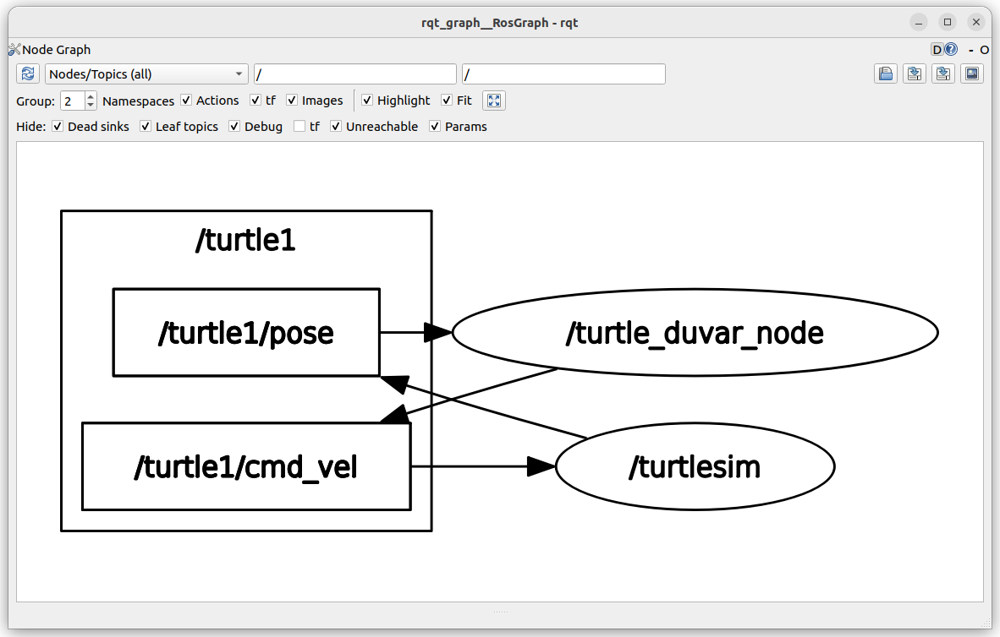
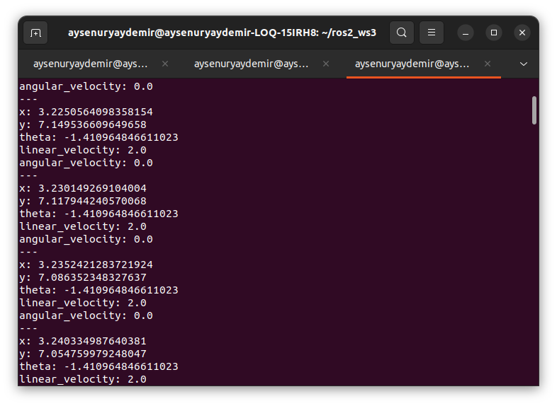
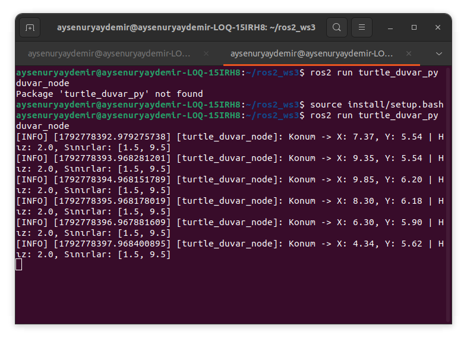
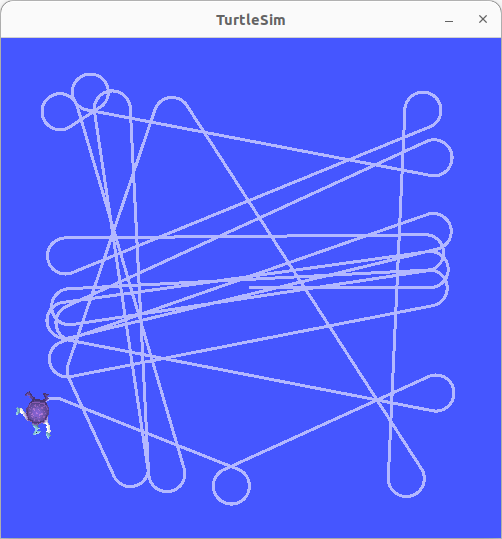
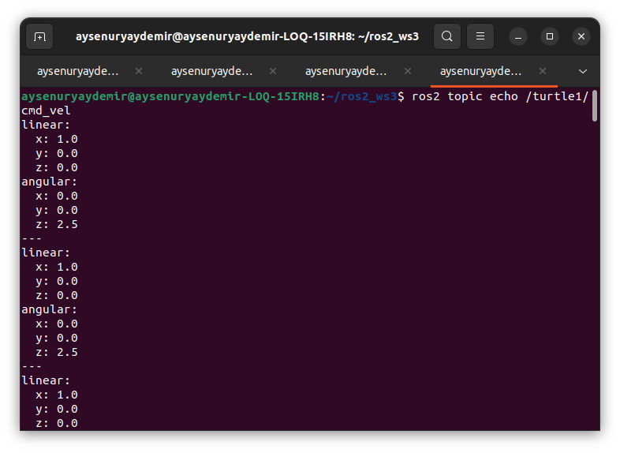

# 🐢 ROS 2 Duvarlardan Kaçan Kaplumbağa Paketi (`turtle_duvar_py`)

Bu proje, ROS 2 (Humble Hawksbill) ve Turtlesim kullanılarak Python programlama diliyle geliştirilmiş, kaplumbağanın konumunu takip ederek duvarlardan kaçmasını sağlayan bir ROS 2 Python paketidir.

Sistem, ROS 2'nin yayıncı-abone (Publisher-Subscriber) iletişim mimarisini kullanarak düğümler arasında veri alışverişini gerçekleştirir. Kaplumbağanın konum bilgileri `/turtle1/pose` konusu üzerinden alınırken hareket komutları `/turtle1/cmd_vel` konusu üzerinden gönderilir. Belirlenen sınır değerlerine yaklaşıldığında kaplumbağanın yönü değiştirilerek simülasyon ekranının sınırları içerisinde kalması sağlanır.

---

## 📂 Proje Yapısı

- **`turtle_duvar_node` (Kontrol Düğümü):** Kaplumbağanın konumunu takip eder, sınır koşullarını kontrol eder ve uygun hareket komutlarını üretir.
- **Konum Takibi (Abone):** `/turtle1/pose` konusunu dinleyerek kaplumbağanın anlık `x`, `y` ve `theta` değerlerini alır.
- **Hareket Kontrolü (Yayıncı):** `/turtle1/cmd_vel` konusu üzerinden doğrusal ve açısal hız komutları göndererek kaplumbağanın hareketini kontrol eder.
- **Parametre Desteği:** Hız ve sınır değerlerinin parametreler aracılığıyla yapılandırılmasına olanak tanır.
- **Mesaj Türleri:** Konum bilgileri için `turtlesim/msg/Pose`, hareket komutları için `geometry_msgs/msg/Twist` mesaj türleri kullanılır.

---

## 📊 RQT Graph ve Terminal Çıktıları

### 1. RQT Graph Çıktısı

Aşağıdaki `rqt_graph` görselinde, Turtlesim simülatörü ile `turtle_duvar_node` arasındaki veri iletişim yapısı gösterilmektedir. Kontrol düğümü, `/turtle1/pose` konusu üzerinden kaplumbağanın konum bilgilerini alırken `/turtle1/cmd_vel` konusu üzerinden hareket komutlarını yayınlamaktadır.

ROS 2'nin yayıncı-abone iletişim mimarisi sayesinde kaplumbağanın konum takibi ve hareket kontrolü topic tabanlı haberleşme üzerinden gerçekleştirilmektedir.



### 2. Pose (Konum) Çıktısı

Kaplumbağanın konum bilgileri, `/turtle1/pose` konusu üzerinden alınmaktadır. Bu bilgiler arasında yatay konumu (`x`), dikey konumu (`y`), yön açısı (`theta`), doğrusal hızı (`linear_velocity`) ve açısal hızı (`angular_velocity`) bulunmaktadır.

Aşağıdaki terminal çıktısı, kaplumbağanın simülasyon sırasındaki anlık konum ve hareket bilgilerinin izlenmesini göstermektedir.



### 3. Duvar Kontrolü ve Terminal Logları

Duvar kontrol düğümü, kaplumbağanın konumunu belirlenen sınır değerleriyle karşılaştırır. Kaplumbağa sınırlara yaklaştığında hareket yönünü değiştirecek kontrol mekanizması devreye girer.

Terminal çıktısında `get_logger().info()` aracılığıyla kaplumbağanın anlık konumu ve sınır kontrolüne ilişkin bilgiler görüntülenebilir.



### 4. Turtlesim Simülasyon Hareketi

Aşağıdaki görselde, kaplumbağanın Turtlesim simülasyon ekranındaki hareketi gösterilmektedir. Sistem, sınır koşullarını kontrol ederek kaplumbağanın duvarlara çarpmasını önlemeyi ve simülasyon alanında hareket etmesini amaçlamaktadır.



### 5. Cmd Vel (Hareket Komutları) Çıktısı

`/turtle1/cmd_vel` konusu üzerinden kaplumbağanın hareketini kontrol etmek için `geometry_msgs/msg/Twist` mesajları gönderilir.

Bu mesajlarda bulunan `linear` alanı doğrusal hareket hızını, `angular` alanı ise açısal hareket hızını belirtir. Aşağıdaki terminal çıktısı, kaplumbağaya gönderilen hareket komutlarını göstermektedir.



---

## 🚀 Kurulum ve Çalıştırma

Projeyi kendi ROS 2 çalışma alanınızda (`ros2_ws/src`) çalıştırmak için aşağıdaki adımları izleyebilirsiniz:

```bash
cd ~/ros2_ws

colcon build --packages-select turtle_duvar_py

source install/setup.bash
```

---

## 👩‍💻 Geliştirici

**Ayşe Nur Yaydemir**

GitHub: [Ayse-Nur-Yaydemir](https://github.com/Ayse-Nur-Yaydemir)

Proje deposu: [turtle_duvar_py](https://github.com/Ayse-Nur-Yaydemir/turtle_duvar_py)
